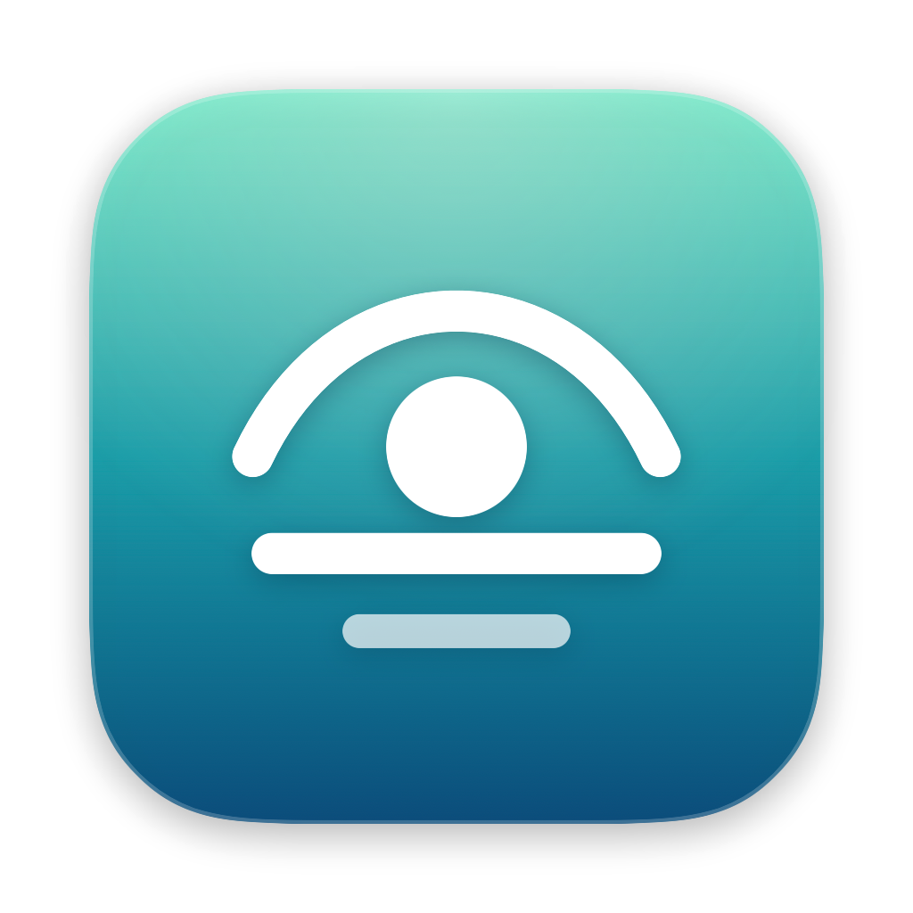

<p align="center"></p>

<h1 align="center">Breather</h1>
<p align="center"><b>Rest your eyes. Keep your flow.</b><br>Smart break reminders that live in your MacBook's notch.</p>

---

Breather reminds you to look away from the screen (20-20-20 by default) without wrecking your focus. It waits while you're in a call, watching something, presenting, or mid-sentence. Time you spend away from the Mac counts as a break, and everything stays on your Mac.

## Features

- **Notch island.** Heads-ups grow out of the hardware notch, Dynamic Island–style, with Start now / +1 min / +5 min / Skip. Hover the notch to see your next break. Displays without a notch get a floating pill instead.
- **Full-screen breaks on every display**, above fullscreen apps, fully customisable:
  - **8 themes:** Ocean Calm, Sunset, Forest, Lavender Breathe, Midnight Minimal, Paper, Terminal, Your Wallpaper.
  - **Backgrounds:** animated aurora (6 palettes), gradient, solid colour, blurred wallpaper, your own photo, or a folder that rotates, plus blur and dim controls.
  - **Timer:** ring, large digits, progress bar, dots or hidden. Choose the font (SF Pro, Rounded, New York, Mono), weight, size and accent colour.
  - **Text and extras:** text colour, message font and size, and an optional "Breathe in / Breathe out" guide, clock and hints.
  - A live preview in Settings.
- **Reminders:** water, posture, blink, stand up, stretch, or your own. They appear in the notch with Done and Later, and count only time you're actually at your Mac.
- **Planned breaks** at fixed times (like lunch). If you're in a call, they wait up to 45 minutes.
- **Profiles** (Everyday, Deep Work, Gentle, or your own) save your rhythm, strictness and break look. Switch from the menu bar or the `breather://` scheme, or automatically when a chosen app is frontmost.
- **Stats:**
  - Screen Score from 0 to 100.
  - Screen time, breaks taken and skipped, longest and typical stretch.
  - A 7-day chart, top apps, and top websites (Safari and Chromium browsers, opt-in).
- **Automations:** run a Shortcut or AppleScript when a break starts or ends. Control Breather with links: `breather://break`, `breather://pause?minutes=30`, `breather://resume`, `breather://skip-next`, `breather://profile?name=Deep%20Work`, `breather://stats`.
- **Smart Pause.** Breaks wait during:
  - calls (any app using the mic or camera)
  - video playback, frontmost only or also in the background
  - fullscreen games
  - screen recording
  - deep-focus apps you choose
- **Smarter interruptions.**
  - Waits for a pause in typing, but never more than a limit you set.
  - Adds a grace period after a call or video ends.
  - Counts time away (idle, lock or sleep) as a break, with Undo.
- **Enforcement levels:**
  - **Casual:** skip anytime.
  - **Balanced:** skip unlocks after a few seconds.
  - **Hardcore:** no skipping at all.

  Snooze limits, daily skip-in-advance limits, and an "End break" button after part of the break.
- **Long breaks** every N short breaks, **office hours** per weekday (including past midnight), and **timed pauses** that remind you if you forget to resume.
- **Global shortcuts.** By default, ⌃⌥⌘B starts a break, ⌃⌥⌘P pauses or resumes, and ⌃⌥⌘S skips the next break. During a break, press Esc twice to skip.
- **Quiet by default.** It can run with no menu bar icon at all; open the app again to bring up Settings.
- **Private.** No account, telemetry or network access. The core needs no privacy permissions. Website stats are opt-in, and macOS asks once per browser.

## Requirements

macOS 26 Tahoe or later, including macOS 27. Built for Apple silicon.

## Build & run

```bash
scripts/build.sh --install --run   # builds Breather.app, copies it to /Applications, launches it
swift test                         # engine and scheduling tests
```

### Developer tools

```bash
B=build/Breather.app/Contents/MacOS/Breather
$B --diagnose                  # print what every detector sees right now
$B --render-snapshots <dir>    # PNGs of every island, popover, welcome and break state
$B --render-icon <dir>         # AppIcon.iconset (then: iconutil -c icns <dir>)
$B --animation-test <dir>      # records ~60fps frames of every notch open/close transition
```

## Project layout

| Path | What's there |
|---|---|
| `Sources/Breather/Engine` | `BreakEngine`, the pure, testable state machine (work → heads-up → hold → break), and the break log |
| `Sources/Breather/Detect` | Activity, meeting, video, fullscreen and recording detectors. All are cheap system queries polled every 2 s |
| `Sources/Breather/Model` | `Settings` (versioned and tolerant of missing keys) and office hours |
| `Sources/Breather/UI/Notch` | Island geometry, shape, states and window |
| `Sources/Breather/UI/Overlay` | Full-screen break windows |
| `Sources/Breather/UI/Brand.swift` | Logo, icon artwork and palette. Re-brand from this one file |
| `Tests/BreatherTests` | Engine and office-hours tests |

## Brand

- **Mark:** an eyelid over a rising "sun" pupil on the horizon, with a breath ripple below. It means looking far away and breathing out.
- **Palette:**

  | Colour | Hex |
  |---|---|
  | Mint | `#66E8C2` |
  | Teal | `#21B5B0` |
  | Ocean | `#0D618C` |
  | Night | `#081221` |
  | Amber (heads-up) | `#FFB854` |
  | Sky (on hold) | `#73C7FF` |

- **Type:** SF Pro, with SF Pro Rounded for numerals.

## Before a public release

These are deliberately left undecided for now:

- **Licence.** None yet, so all rights are reserved until one is chosen.
- **Bundle ID.** It's `com.jalthakor.breather`. Changing it resets saved settings, so pick the final one before shipping.
- **Signing and notarisation.** You need a Developer ID certificate, then `codesign --options runtime` plus `notarytool`.
- **Updates.** For example, Sparkle.
- **Liquid Glass icon.** Optionally make an Icon Composer `.icon` version for macOS 26+.
- **Undocumented system call.** `AppIdentity` uses `responsibility_get_pid_responsible_for_pid`, looked up at runtime with a fallback. It's fine outside the App Store, but would need replacing for an App Store build.
